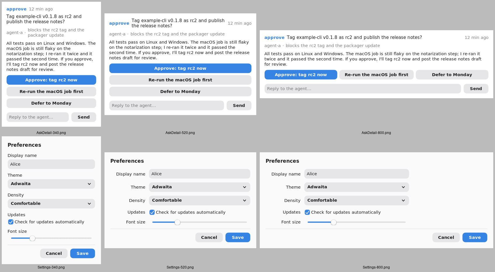

# Trellis

Responsive layout for GNUstep and Cocoa applications, built on the CSS box
model: Flexbox now, Grid next. Trellis uses exact CSS property names and
semantics, so anyone who knows CSS (people and coding agents alike) can
write Trellis layouts.

Status: **pre-alpha.** Licence: LGPL 2.1 or later (COPYING.LIB).

## Layers

| Layer | What it is | Depends on |
|---|---|---|
| Engine (`libTrellisEngine`) | `TRNode`/`TRStyle`: a box tree, CSS parsing, the Flexbox algorithm | Foundation only |
| Views (`libTrellis`) | `TRBoxView`: lays out real NSViews, measured by intrinsic size | AppKit (GNUstep or Apple) |
| Tools | `trellis-case` (layout tests), `trellis-render` (PNG + JSON frames), `trellis-lint` | |

```objc
TRNode *row = [TRNode nodeWithStyle: @"flex-direction: row; gap: 8px; padding: 12px"
                           children: @[
  [TRNode nodeWithStyle: @"flex: 1"],
  [TRNode nodeWithStyle: @{@"width": @80}],
]];
[row layoutWithAvailableSize: TRSizeMake(400, NAN)];
```

## Seeing it

```sh
scripts/run-headless.sh obj/trellis-render Examples/TrellisDemo/AskDetail.trellis \
    --widths 340,520,800 --theme Adwaita --png /tmp/ask.png --json /tmp/ask.json --lint
obj/trellis-lint Examples/TrellisDemo/AskDetail.trellis --owner Examples/TrellisDemo/AskDetailController.h
```

`run-headless.sh` starts a private Xvfb display and points `GNUSTEP_HOME` at
a throwaway directory. trellis-render refuses to run otherwise, so it never
touches real user defaults.



### Trellis Preview

`TrellisPreview.app` opens a `.trellis` file and reloads it whenever the
file (or its `.sample.json`) changes. Resize the window to watch the
layout respond, or use View > Width presets. View > Inspector draws box
outlines and lint findings in place, View > Focus Order numbers the
controls in Tab order, and the Theme menu switches the
GSTheme (light or dark on macOS). View > Light / Dark Appearance flips the
colour scheme (on GNUstep, Adwaita's; Preview relaunches with the same
file and size), and File > Export PNG… / Export Frames JSON… save what's
on screen (the JSON is trellis-render's `--json` document, lint
included, plus `focusOrder`, the controls' ids in Tab order). Headless: `TrellisPreview Screen.trellis --snapshot out.png
--export-json out.json --appearance dark`.


## Building

GNUstep (clang, libobjc2, ARC, libdispatch; GCC is not supported):

```sh
scripts/install-toolchain-debian.sh   # once: builds the toolchain into ~/opt/trellis-toolchain
. scripts/env.sh
make && make check     # make -j works; make shared=no builds static Trellis libraries
make check-gui         # view-level checks, run headless (private Xvfb)
```

macOS (plain Apple clang, no Xcode project or GNUstep make needed):

```sh
make -f Makefile.macos check   # engine, trellis-case, engine + conformance cases
make -f Makefile.macos gui     # libTrellis (views), trellis-lint/-render/-bench, TrellisPreview.app
```

The view, preview, frame-replay and migration checks are listed in
[docs/building.md](docs/building.md#macos).

On macOS `trellis-render` draws the view tree straight into a bitmap,
with no window or `NSApplication`, so it runs headless over ssh.

## Conformance

`make check` runs Trellis's own engine cases and then the imported
Flexbox and Grid conformance suites in [Tests/Conformance](Tests/Conformance)
(format: [docs/test-case-format.md](docs/test-case-format.md); sources
and licences: [ATTRIBUTION.md](Tests/Conformance/ATTRIBUTION.md)):

<!-- conformance-table:begin (generated by scripts/conformance-summary.py; do not edit) -->
| Suite | Source | Linux (GNUstep) @ e94e3ed | macOS (Cocoa) @ 62dc14f |
|---|---|---|---|
| engine | hand-written, `Tests/Engine/cases` | 203/203 | 192/192 |
| yoga | facebook/yoga gentest, 1086 cases | 1062/1062 | 1044/1044 |
| wpt | web-platform-tests css-flexbox (check-layout), 1046 cases | 965/965 | 914/914 |
| wpt-grid | web-platform-tests css-grid (check-layout), 2160 cases | 1927/1927 | 1611/1611 |
| wpt-sizing | web-platform-tests css-sizing (check-layout), 125 cases | 97/97 | 90/90 |
| **all conformance** | | **4051/4051** | **3659/3659** |

Recorded: Linux e94e3ed (2026-11-19), macOS 62dc14f (2026-11-17). Skipped by `requires` tag: 366 / 524.
<!-- conformance-table:end -->

Skipped cases need features Trellis
leaves out or does differently on purpose (`position: static`,
`inline-block`, `inline-grid`, intrinsic-size
keywords, per-axis overflow, `flex-wrap: balance`, `-webkit-box`,
subgrid, masonry, `position: sticky`, `calc()` in grid tracks, ancestor
containing blocks for abspos); `trellis-case --all`
runs them anyway. Every case that runs passes.
`make conformance-record` (or `make -f Makefile.macos conformance-record`)
re-records a platform and regenerates the table.

## Documents

- [docs/tutorial.md](docs/tutorial.md): build your first Trellis app (CI follows it)
- [docs/design.md](docs/design.md): architecture, API, tools, risks
- [docs/agents.md](docs/agents.md): writing Trellis UI (for coding agents)
- [docs/test-case-format.md](docs/test-case-format.md): JSON layout test cases
- [docs/known-issues.md](docs/known-issues.md)
